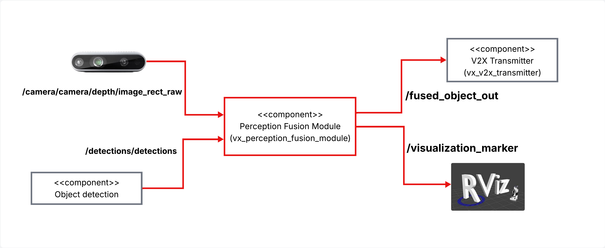

# Perception Fusion Module

## 👥 Contributors

- **Parth Pahinkar** – Perception Fusion Design & Implementation (par8824s@hs-coburg.de)

The **Perception Fusion Module** is a ROS 2 node that fuses 2D object detections from an image-based detector with depth data and TF transforms to produce global 3D object positions and RViz markers. The fused objects are published in a custom message format for downstream modules , while visualization markers allow real-time inspection in RViz.

---

## 📚 Table of Contents

- [🧾 Overview](#-overview)
- [🏗️ Component Architecture](#-component-architecture)
- [📡 ROS2 Topics](#-ros2-topics)
- [#-User-stories](#-user-stories)
- [⚙️ Component Functionalities](#-component-functionalities)
- [   Algorithm Description](#-algorithm-description)
- [🔧 Dependencies](#-dependencies)
- [🛠️ Installation & Setup](#-installation--setup)
- [🧪 Interface Test Procedure](#-interface-test-procedure)

---

## 🧾 Overview

The **Perception Fusion Module** takes 2D detections from `/detectnet/detections`, depth images from `/camera/camera/depth/image_rect_raw`, and camera calibration from `/camera/camera/depth/camera_info`, and combines them with TF transforms between the camera, base link, and map frames to compute 3D, globally referenced object positions.

Key capabilities:

- Convert 2D bounding boxes into 3D points using camera intrinsics and depth.  
- Transform object positions from the camera frame into the vehicle base frame and then into a map frame using TF.  
- Publish fused objects as `vx_custom_msgs/FusedObjects` with positions, classes, IDs, and confidence scores.  
- Publish `visualization_msgs/MarkerArray` for RViz, including cuboid markers and text labels for each object.

---

## 🏗️ Component Architecture

At a high level, the module:

- **Subscribes to:**
  - `/camera/camera/depth/camera_info` (camera intrinsics)  
  - `/camera/camera/depth/image_rect_raw` (depth image)  
  - `/detectnet/detections` (2D detections)

- **Uses TF transforms:**
  - `camera_depth_optical_frame → 6/base_link`  
  - `6/base_link → map`

- **Publishes to:**
  - `/fused_objects_out` (`vx_custom_msgs/FusedObjects`)  
  - `/visualization_marker` (`visualization_msgs/MarkerArray`)



---

##  ROS2 Topics

### Subscribed Topics

| Topic Name                                 | Message Type               | Description                                                 |
|--------------------------------------------|----------------------------|-------------------------------------------------------------|
| `/camera/camera/depth/camera_info`         | `sensor_msgs/CameraInfo`   | Camera intrinsics (`fx`, `fy`, `cx`, `cy`) used for back‑projection. |
| `/camera/camera/depth/image_rect_raw`      | `sensor_msgs/Image`        | Depth image used to estimate distance to detected objects.  |
| `/detectnet/detections`                    | `vision_msgs/Detection2DArray` | 2D object detections (bounding boxes and class predictions). |

### Published Topics

| Topic Name              | Message Type                     | Description                                                              |
|-------------------------|----------------------------------|--------------------------------------------------------------------------|
| `/fused_objects_out`    | `vx_custom_msgs/FusedObjects`    | Fused 3D objects with class, confidence, and positions in base and ENU/map frames. |
| `/visualization_marker` | `visualization_msgs/MarkerArray` | RViz markers (cuboids + text labels) representing detected objects.      |

---
## 📌 User Stories & Acceptance Criteria

### User Story 6.4 – Perception Fusion for Global Object Estimation

**As the Perception Fusion component**,  
I want to combine the outputs from the RealSense depth camera, object detection module 
so that accurate, globally referenced object information can be generated.

#### Acceptance Criteria

- **AC 6.4.1**  
  The Perception Fusion component shall subscribe to the following topics:
  - `/detectnet/detections`
  - `/camera/camera/depth/image_rect_raw`
  - `/camera/camera/depth/camera_info`  
  to receive 2D object detections, depth measurements, and camera intrinsic parameters.

- **AC 6.4.2**  
  The Perception Fusion component shall compute 3D object positions by extracting depth values from the depth image corresponding to each detected bounding box and back-projecting pixel coordinates into the `camera_depth_optical_frame` using the provided camera intrinsics.

- **AC 6.4.3**  
  The Perception Fusion component shall transform detected object positions from the `camera_depth_optical_frame` to the ego vehicle reference frame (`base_link`) using the available TF tree.

- **AC 6.4.4**  
  The Perception Fusion component shall further transform object positions from the ego vehicle frame (`base_link`) into the global `map` frame using localization transforms available in the TF tree.

- **AC 6.4.5**  
  The Perception Fusion component shall publish the fused object data on the `/fused_objects_out` topic, where each fused object includes:
  - Object identifier  
  - Object class  
  - Confidence score  
  - 3D position expressed in the map frame  
  - Timestamp  

---

### User Story 5.2 – RViz Visualization of Fused Objects

**As the Perception Fusion component**,  
I want to visualize objects detected by the ego vehicle in RViz,  
so that each object is shown at the correct position in the map and can be clearly distinguished by class.

#### Acceptance Criteria

- **AC 5.2.1**  
  The detected objects shall be visualized in RViz at their correct positions in the `map` frame.

- **AC 5.2.2**  
  Each detected object shall be shown as a cuboid in RViz, with dimensions corresponding to model city objects such as a car, person, or potted plant.

- **AC 5.2.3**  
  Each object’s cuboid in RViz shall be uniquely colored according to its semantic class.

- **AC 5.2.4**  
  The position of each object shall be continuously updated in RViz based on new detections, reflecting real-time positions in the map frame.

- **AC 5.2.5**  
  The detected objects shall have a controlled lifetime in RViz and shall disappear once they are no longer detected.

- **AC 5.2.6**  
  Each detected object shall display its semantic class label in RViz as a text marker positioned above the corresponding cuboid.

- **AC 5.2.7**  
  Each detected object shall display its detection confidence score in RViz, enabling users to assess the reliability of each detection.

- **AC 5.2.8**  
  The transparency of each object’s cuboid shall be scaled based on the object’s confidence score.


## ⚙️ Component Functionalities

The Perception Fusion Module combines 2D object detections with depth camera information to estimate real-world 3D positions of detected objects.

For each incoming 2D detection, the component:
- Extracts the corresponding region of interest (ROI) from the depth image.
- Uses camera intrinsic parameters to back-project image coordinates into 3D space relative to the camera frame.
- Computes a stable depth value for the detection using a histogram-based depth selection method.
- Transforms the resulting 3D point through the TF tree to obtain object positions in both the robot base frame and the global map frame.

Only detections for which all required data (depth, intrinsics, and TF transforms) are available are processed. This guarantees that all published object positions are geometrically valid and spatially consistent.

The component publishes the fused object data for downstream modules such as V2X / CPM generation and simultaneously generates RViz visualization markers. These markers provide a clear 3D representation of detected objects in the environment, including their class labels and confidence scores, enabling straightforward monitoring and debugging of the perception pipeline during runtime.

---
##  Algorithm Description: Histogram-Based Depth Selection

To obtain a robust depth estimate for each detected object, the module applies a histogram-based depth selection algorithm over the object’s bounding box.

First, all depth values inside the detection’s ROI are extracted from the depth image. Invalid measurements (zero values, NaNs, or values outside a predefined depth range) are removed to ensure only physically meaningful distances are considered.

The remaining depth values are then grouped into a histogram over a fixed depth interval. Each bin represents the number of pixels whose depth falls within a small range. The bin with the highest count is selected, as it corresponds to the most frequently observed depth within the bounding box. This dominant depth is assumed to represent the actual object surface rather than background structures or sensor noise.

A representative depth value is computed from the selected histogram bin and used for 3D back-projection. Compared to using a simple mean or minimum depth, this approach significantly reduces the influence of outliers and background pixels, resulting in a more stable and repeatable 3D position estimate for each detected object.

---

## 🔧 Dependencies

The Perception Fusion Module relies on these runtime dependencies in the ROS 2 system:

- **Depth Camera Pipeline**  
  Must provide:
  - `/camera/camera/depth/camera_info` (`sensor_msgs/CameraInfo`)  
  - `/camera/camera/depth/image_rect_raw` (`sensor_msgs/Image`)

- **Object Detection Pipeline (DetectNet)**  
  Must provide:
  - `/detectnet/detections` (`vision_msgs/Detection2DArray`)

- **TF Tree**  
  Must provide valid transforms:
  - `camera_depth_optical_frame → 6/base_link`  
  - `6/base_link → map`

- **Car Description Module**  
  - Launch file:  
    ```
    ros2 launch car_description visualize_all.launch.py
    ```  
  - Used to load the ego vehicle  ** for visual representation** in RViz 
  
  **model city map**
  - Launch file:
     ```
     ros2 launch nav2_bringup localization_launch.py map:=$(pwd)'/mc24.yaml'
     ```
   

---

## 🛠️ Installation & Setup

All commands assume a correctly set up ROS 2 workspace.

1. **Build the package:**
colcon build --packages-select sensor_fusion_cpm


2. **Source the workspace:**
source install/setup.bash


3. **Run the Perception Fusion Node:**
ros2 run sensor_fusion_cpm perception_fusion_node


4. **Launch the Camera (example, RealSense):**
ros2 launch realsense2_camera rs_launch.py


5. **Launch the Object Detection (DetectNet):**
ros2 launch ros2_deep_learning detectnet.ros2.launch input:=/camera/camera/colcon/image_raw


6. **Launch the Car Description Module (Ego Vehicle and Model City Map):**
ros2 launch car_description visualize_all.launch.py


Ensure the TF tree correctly links `camera_depth_optical_frame`, `6/base_link`, and `map` before testing the fusion outputs.

---

## 🧪 Interface Test Procedure

1. **Source the workspace:**
source install/setup.bash


2. **Check available topics:**
ros2 topic list


Verify that at least the following topics are present:
- `/camera/camera/depth/camera_info`  
- `/camera/camera/depth/image_rect_raw`  
- `/detectnet/detections`  
- `/fused_objects_out`  
- `/visualization_marker`

3. **Echo the fused objects:**
ros2 topic echo /fused_objects_out


4. **Visualize markers in RViz:**
- Add a `MarkerArray` display with topic `/visualization_marker`.  
- Load the ego vehicle and model city map from the Car Description Module.  
- Confirm that cuboids and labels appear at plausible locations relative to the vehicle and environment.
